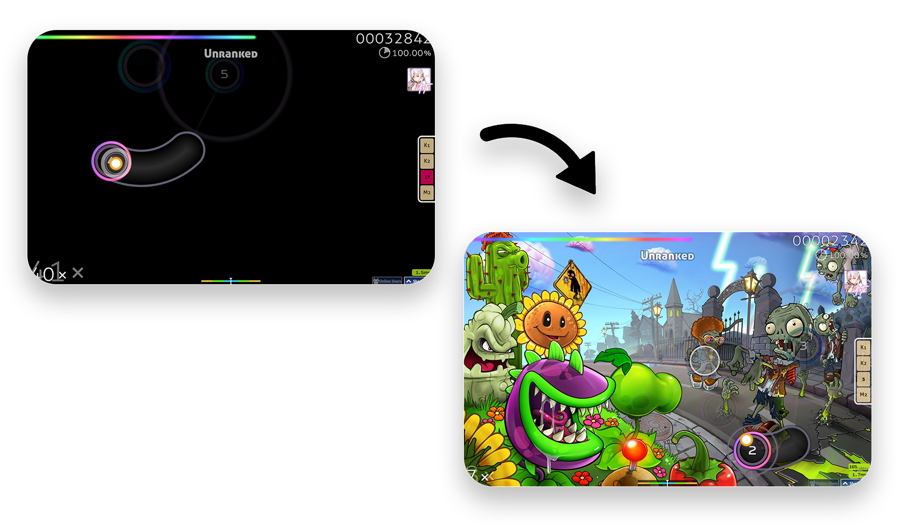

# osu! Background Replacer

<p align="center">
  
</p>

<p align="center">
  <strong>A modern Windows 10 / 11 WinUI 3 desktop utility for safely and rapidly replacing background images across all beatmaps in your osu! Songs library in a single batch operation.</strong>
</p>

<p align="center">
  <a href="https://dotnet.microsoft.com/download/dotnet/11.0"></a>
  <a href="https://learn.microsoft.com/en-us/windows/apps/winui/winui3/"></a>
  
  <a href="https://jrsoftware.org/isinfo.php"></a>
  
</p>

---

<p align="center">
   
</p>


## Downloads & Installation

Choose the distribution format from the [Releases](https://github.com/yakimi27/osu-background-replacer/releases) page that best fits your system:

| Package | Type | Prerequisites | Description |
|:---|:---:|:---:|:---|
| **[OsuBackgroundReplacer-2.0.0-win-x64-setup.exe](https://github.com/yakimi27/osu-background-replacer/releases)** | **Installer (Self-Contained)** | *None* | **Recommended.** Guided Inno Setup wizard with Start Menu shortcuts, optional Desktop icon, and full uninstaller. Bundles .NET 11 and Windows App SDK 1.8 (~72 MB). |
| **[OsuBackgroundReplacer-2.0.0-win-x64-portable.zip](https://github.com/yakimi27/osu-background-replacer/releases)** | **Portable (Self-Contained)** | *None* | Standalone portable bundle with embedded .NET 11 and Windows App SDK 1.8 runtimes — extract and run `OsuBackgroundReplacer.exe` anywhere without installing (~103 MB). |
| **[OsuBackgroundReplacer-2.0.0-win-x64-framework-dependent-setup.exe](https://github.com/yakimi27/osu-background-replacer/releases)** | **Installer (Lightweight)** | [.NET 11 Desktop Runtime](https://dotnet.microsoft.com/download/dotnet/11.0) & [Windows App SDK 1.8](https://learn.microsoft.com/en-us/windows/apps/windows-app-sdk/downloads) | Lightweight Inno Setup installer for systems that already have the .NET 11 and Windows App SDK 1.8 runtimes installed (~11 MB). |
| **[OsuBackgroundReplacer-2.0.0-win-x64-framework-dependent-portable.zip](https://github.com/yakimi27/osu-background-replacer/releases)** | **Portable (Lightweight)** | [.NET 11 Desktop Runtime](https://dotnet.microsoft.com/download/dotnet/11.0) & [Windows App SDK 1.8](https://learn.microsoft.com/en-us/windows/apps/windows-app-sdk/downloads) | Minimal portable archive for users who already have .NET 11 and Windows App SDK 1.8 installed (~15 MB). |

> [!NOTE]
> The installers use per-user installation (`PrivilegesRequired=lowest`) by default so WinUI 3 file/folder pickers and Drag & Drop are not blocked by UAC elevation / UIPI.

## Features

- **Batch Background Replacement**: Scans all beatmap sets in your `Songs` directory and replaces background images across thousands of beatmaps in seconds.
- **Accurate `.osu` Beatmap Parser**: Parses `[Events]` sections in `.osu` beatmap files to extract exact background filenames while ignoring video and storyboard assets, with path-traversal validation.
- **Drag & Drop Integration**: Drag and drop your osu! `Songs` folder or target replacement image (`.jpg`, `.jpeg`, `.png`) directly into the app with real-time file-type validation and active visual states.
- **Automatic Folder Detection**: One-click **Auto-detect** scans default osu! installation locations across drives.
- **Non-Destructive Backups & 1-Click Undo**: Safely archives original backgrounds into timestamped sessions with SHA-256 `manifest.json` verification before replacement, and restores them with **Undo last replacement**.
- **Detailed Activity Logging**: Real-time event log with per-file success/failure statuses and export to file.
- **Modern Windows 11 UI**: Fluent 2 / WinUI 3 design language with Mica material, Light/Dark/Default theme support, and responsive layouts.

https://github.com/user-attachments/assets/1ad1a6e2-6748-4e6f-978a-e985fecfab16

## Usage

1. **Select osu! Songs Directory**:
   - Click **Auto-detect** to locate your osu! `Songs` directory automatically.
   - Or click **Browse...** / drag & drop your `Songs` folder into the drop zone.
   - An indicator displays the total number of beatmap folders discovered.
2. **Choose Replacement Image**:
   - Click **Browse Image...** or drag & drop a `.jpg`, `.jpeg`, or `.png` file.
   - The preview card displays the image dimensions, file size, and thumbnail.
3. **Configure Backup (Recommended)**:
   - Enable **Backup original backgrounds** to archive original images before replacing.
4. **Run Replacement**:
   - Click **Replace Backgrounds**.
   - Review the confirmation dialog. If the selected directory is outside a standard `osu!\Songs` path, a warning dialog appears so you can verify before proceeding.
   - Progress bar and status indicators update live during execution.
5. **View Results or Undo**:
   - Check the **Activity Log** for detailed per-file replacement outcomes.
   - Click **Undo last replacement** at any time to restore original backgrounds from the most recent backup session.

## Backup, Undo & Data Locations

### Backup & Undo Behavior
- **Session-Based Backups**: Every replacement run with backups enabled creates a timestamped session under `Backups\` (e.g. `2026-10-14_17-00-00\`).
- **Integrity Verification**: Each session includes a `manifest.json` indexing original file paths, backup copies, and SHA-256 cryptographic hashes.
- **Safe Restoration**: **Undo** verifies file integrity and restores original images to their respective beatmap folders. Missing files or modified beatmaps are reported gracefully without aborting the restore.
- **Session Retention Management**: Configure how many backup sessions to keep in **Settings** (default: `5` sessions; set to `0` for unlimited). Older sessions are automatically purged after successful runs to manage disk space.

### Settings & Backup Directory
All user configurations and backup files reside under a single unified root directory:

```text
%LocalAppData%\OsuBackgroundReplacer\
├── settings.json       # User preferences, saved paths, theme, and retention limits
└── Backups\            # Timestamped backup sessions and file manifests
    └── YYYY-MM-DD_HH-mm-ss\
        ├── manifest.json
        └── ...
```

### Automatic Migration
On first launch, the application checks for legacy data previously stored under `%LocalAppData%\yakimi27\OsuBackgroundReplacer\`. Any existing backup sessions and settings are migrated to `%LocalAppData%\OsuBackgroundReplacer\` automatically without data loss.

## Important Notes

> [!IMPORTANT]
> - **Do not run as Administrator**: Running an unpackaged WinUI 3 app elevated can break Drag & Drop (due to Windows UIPI) and interfere with standard file/folder pickers.
> - **Enable backups before large runs**: Keep **Backup original backgrounds** turned on if you may want to revert your beatmap backgrounds later.
> - **Custom folder safety check**: If you target a folder outside a standard `osu!\Songs` directory, the app prompts for confirmation to prevent accidental bulk overwrites.

## Architecture

```text
osu-background-replacer/
├── OsuBackgroundReplacerMain/       # WinUI 3 (.NET 11 / Windows App SDK 1.8) desktop app
│   ├── Assets/                      # App icons and package visual assets
│   ├── Controls/                    # Custom UI controls (SettingsCard)
│   ├── Logic/                       # Batch replacement engine & .osu beatmap parser
│   ├── Models/                      # Data models (LogEntry)
│   ├── Services/                    # BackupService, SettingsService, LogService, DialogQueue
│   ├── Views/                       # ReplacePage, ActivityLogPage, SettingsPage
│   ├── MainWindow.xaml              # Navigation shell and Mica backdrop
│   └── OsuBackgroundReplacerMain.csproj
│
├── OsuBackgroundReplacer.Tests/     # Automated unit, backup, parser, and scale tests
├── installer/                       # Inno Setup script (OsuBackgroundReplacer.iss) & release script
└── OsuBackgroundReplacer.sln        # Visual Studio / .NET solution file
```

## Building & Packaging from Source

### Prerequisites
- **Operating System**: Windows 10 version 1809 (Build 17763) or higher, or Windows 11 (`x64`, `x86`, or `ARM64`).
- **SDK**: [.NET 11.0 SDK](https://dotnet.microsoft.com/download/dotnet/11.0) (`net11.0-windows10.0.19041.0`).
- **Platform Package**: Windows App SDK 1.8 (`Microsoft.WindowsAppSDK`).
- **IDE (Optional)**: Visual Studio 2022 (v17.8+) with *.NET Desktop Development* and *Windows App SDK C# Templates*.
- **Installer (Optional)**: [Inno Setup 6](https://jrsoftware.org/isinfo.php) (`ISCC.exe`) for building `.exe` installers.

### 1. Build & Test Locally
```powershell
# Clone the repository
git clone https://github.com/yakimi27/osu-background-replacer.git
cd osu-background-replacer

# Build application (x64)
dotnet build OsuBackgroundReplacerMain\OsuBackgroundReplacerMain.csproj -p:Platform=x64

# Run test suite
dotnet test
```

### 2. Package All 4 Release Builds (`out/`)
```powershell
# Publishes self-contained and framework-dependent builds, builds Inno Setup installers,
# and creates portable ZIP archives in out/
.\installer\build-release.ps1 -Arch x64 -Flavor both -CreatePortableZip
```

### Trimming & ReadyToRun Notes
- `PublishReadyToRun` is enabled for non-Debug configurations.
- `PublishTrimmed` is enabled for **Release + Self-Contained** builds (`Configuration != Debug` and `SelfContained != false`) to reduce package size and startup time.
- `PublishTrimmed` is explicitly **disabled** for **Debug** and **Framework-Dependent** (`SelfContained == false`) builds.

## License

Distributed under the [MIT License](LICENSE).

## Acknowledgements
Demo video recorded with [Recordly](https://github.com/webadderallorg/Recordly) — an open-source screen recorder.
